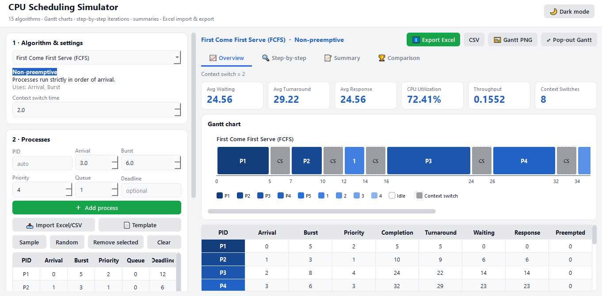
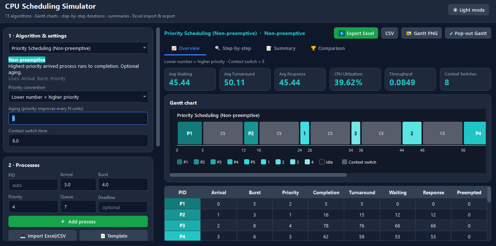
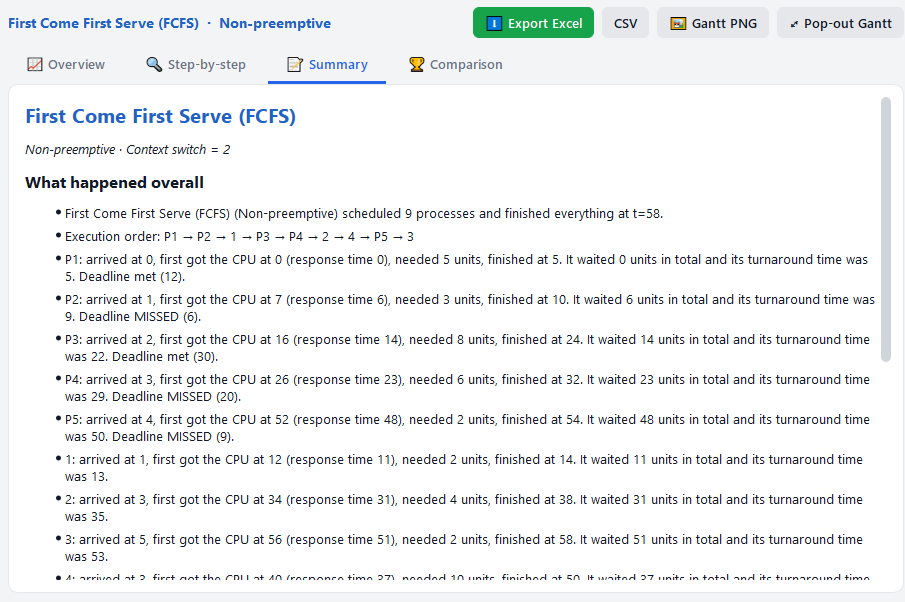
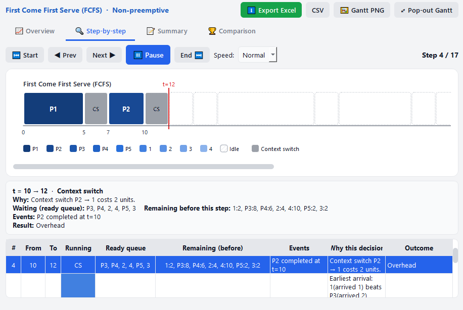
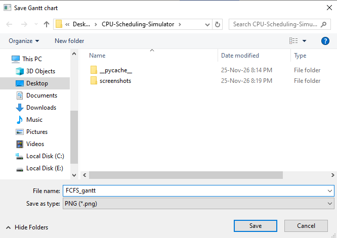
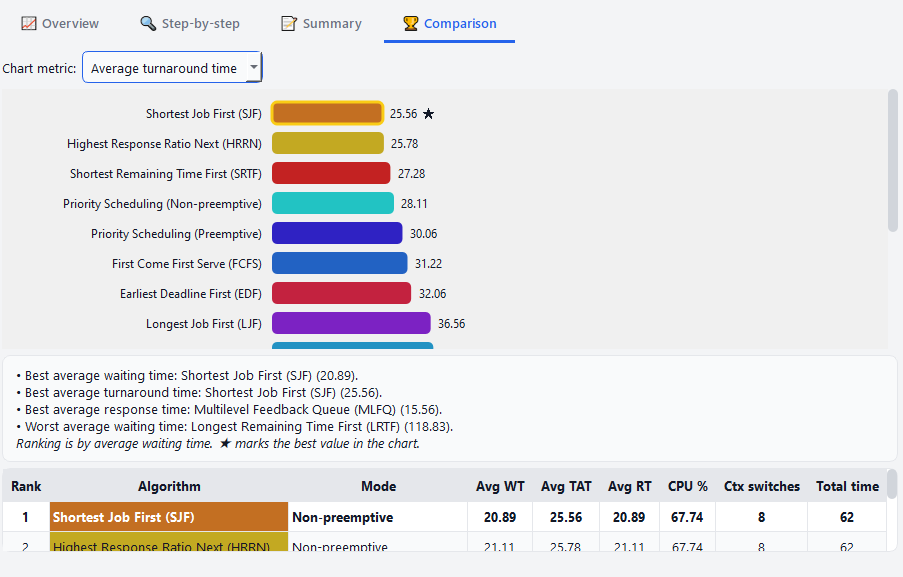
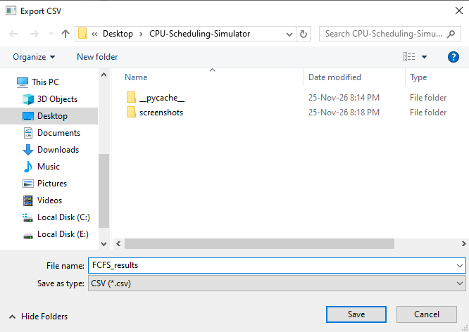

<p align="center">
  
</p>

# CPU Scheduling Simulator

A desktop application for learning and comparing CPU scheduling algorithms. Built with Python and PyQt6, it provides process configuration, step-by-step simulation, Gantt charts, performance metrics, algorithm comparison, and import/export tools.

## Goal

The project makes operating-system CPU scheduling behavior easier to understand through visual simulation. It calculates completion, turnaround, waiting, and response times while demonstrating ready-queue changes, arrivals, preemption, idle time, and context switches.

## Implemented CPU Schedulers

| Algorithm | Key | Type | Description |
|---|---|---|---|
| First Come First Serve | `FCFS` | Non-preemptive | Executes arrived processes in arrival order. |
| Shortest Job First | `SJF` | Non-preemptive | Runs the arrived process with the shortest burst time next. |
| Shortest Remaining Time First | `SRTF` | Preemptive | Continuously runs the process with the least remaining burst time. |
| Longest Job First | `LJF` | Non-preemptive | Runs the arrived process with the longest burst time next. |
| Longest Remaining Time First | `LRTF` | Preemptive | Continuously runs the process with the greatest remaining burst time. |
| Round Robin | `RR` | Preemptive | Uses a fixed time quantum and processes jobs in circular order. |
| Priority Scheduling | `PRIO_NP` | Non-preemptive | Runs the highest-priority arrived process to completion. |
| Priority Scheduling | `PRIO_P` | Preemptive | Runs the highest-priority process and allows a higher-priority arrival to preempt it. |
| Priority + Round Robin | `PRIO_RR` | Preemptive | Uses priority across groups and Round Robin for processes with equal priority. |
| Highest Response Ratio Next | `HRRN` | Non-preemptive | Selects the process with the highest `(waiting time + burst time) / burst time` ratio. |
| Multilevel Queue | `MLQ` | Queue-based | Assigns processes to fixed queues and uses a configured scheduling policy for each queue. |

Priority convention, priority aging, context-switch time, quantum, queue configuration, and other algorithm-specific options are configurable in the application.

## Features

- Enter, edit, add, delete, duplicate, clear, and randomly generate processes.
- Import process data from Excel (`.xlsx`) or CSV (`.csv`).
- Download an Excel process template.
- Run one algorithm or compare all 15 algorithms.
- Display Gantt charts in the main window or in a separate window.
- Replay scheduling decisions step by step.
- View waiting, turnaround, completion, response, utilization, throughput, idle time, and context-switch metrics.
- Export reports to Excel or CSV and export Gantt charts to PNG.
- Switch between light and dark themes.

## Screenshots

### FCFS in Light Mode



The main FCFS view presents algorithm settings, process configuration, Gantt chart visualization, performance metrics, and the detailed results table in the light theme.

### Dark Mode



Switch between light and dark themes to use the simulator in either interface style. The dark theme provides the same scheduling, chart, process, and comparison controls with a low-light appearance.

### Detailed FCFS Summary



The summary view explains the overall execution order and provides process-by-process details about completion, turnaround, waiting, response, and deadline results.

### Step-by-Step Execution



Step-by-step mode lets you replay the simulation decision by decision. Each step shows the running process, ready queue, remaining burst times, context switches, and the reason for the scheduling outcome.

### Gantt Chart Export



The Gantt chart can be exported as a PNG image using a standard save dialog for use in reports, presentations, or coursework.

### Algorithm Comparison



The comparison feature ranks all supported algorithms by selectable metrics such as average turnaround time, waiting time, response time, CPU utilization, or context switches.

### CSV Export



Simulation results can be exported to CSV, making the process metrics and scheduling results available for spreadsheets and further analysis.

## Requirements

- Windows, Linux, or macOS
- Python 3.10 or newer
- PyQt6
- openpyxl
- matplotlib

## Installation

From a terminal, open the project directory:

```bash
cd CPU-Scheduling-Simulator-main
```

Create a virtual environment:

### Windows (PowerShell)

```powershell
py -m venv .venv
.venv\Scripts\Activate.ps1
python -m pip install --upgrade pip
pip install -r requirements.txt
```

### Linux or macOS

```bash
python3 -m venv .venv
source .venv/bin/activate
python3 -m pip install --upgrade pip
pip install -r requirements.txt
```

If PowerShell blocks virtual-environment activation, run:

```powershell
Set-ExecutionPolicy -Scope Process -ExecutionPolicy Bypass
.venv\Scripts\Activate.ps1
```

## Running the Application

```bash
python main.py
```

Alternatively, on Windows use:

```powershell
py main.py
```

Deactivate the virtual environment when finished:

```bash
deactivate
```

## Using the Simulator

1. Set each process's arrival time, burst time, and optional priority, queue, or deadline.
2. Configure the required quantum, context-switch time, priority convention, aging or queue levels.
3. Select an algorithm and run it.
4. Use the Results, Summary, Steps, or Gantt views to inspect the outcome.
5. Use **Compare All** to rank and compare every algorithm for the current process set.
6. Export the report or Gantt chart if needed.

## Excel and CSV Input Format

The first row must contain the column headers. Supported header aliases include the names below.

| Column | Required | Used by |
|---|---:|---|
| `PID` | No | Process identification |
| `Arrival Time` | Yes | All algorithms |
| `Burst Time` | Yes | All algorithms |
| `Priority` | No | Priority, and MLQ algorithms |
| `Queue` | No | Multilevel Queue |
| `Deadline` | No | Earliest Deadline First |

Example:

| PID | Arrival Time | Burst Time | Priority | Queue | Deadline |
|---|---:|---:|---:|---:|---:|
| P1 | 0 | 5 | 2 | 0 | 12 |
| P2 | 1 | 3 | 1 | 0 | 6 |
| P3 | 2 | 8 | 4 | 1 | 30 |
| P4 | 3 | 6 | 3 | 1 | 20 |

`Arrival Time` and `Burst Time` must be numbers. Arrival time cannot be negative, and burst time must be greater than zero.

## Project Structure

```text
CPU-Scheduling-Simulator-main/
|-- main.py                         # PyQt6 desktop application and GUI
|-- scheduler_engine.py             # Scheduling algorithms and simulation engine
|-- gantt_window.py                 # Gantt-chart widgets and pop-out window
|-- data_io.py                      # Excel/CSV import and report/export functions
|-- test_schedulers.py              # Scheduler, invariant, and I/O tests
|-- requirements.txt                # Python dependencies
|-- sample_processes.xlsx           # Example process input workbook
|-- cpu_scheduling_dynamic_v2.ipynb
|-- assets/                        # README banner and application screenshots
|-- LICENSE
|-- README.md
`-- .gitignore
```

## Running Tests

Run the test suite from the project root:

```bash
python -m unittest -v
```

The tests validate scheduler results, random-input invariants, context switches, priority aging, deadlines, queues, and Excel/CSV/PNG exports.
